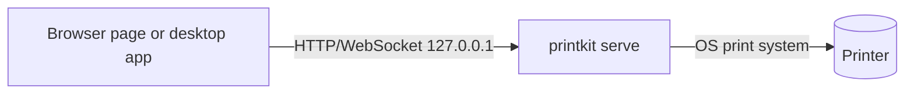

# printkit

Declarative JSON to PDF and paper, on the machine the user is sitting at. A
document is JSON; `printkit` renders it with the system WebView and either
writes a PDF or sends it to a printer. No browser runtime, no backend, no cloud.

English | [Chinese](README.zh-CN.md)

[](https://github.com/xqh-jason/printkit/actions/workflows/ci.yml)
[](https://github.com/xqh-jason/printkit/actions/workflows/release.yml)
[](LICENSE-MIT)
[](#platform-support)

## Status

- Latest published release: **[v0.2.4](https://github.com/xqh-jason/printkit/releases/tag/v0.2.4)**.
- `main` is **0.2.6-dev**; it is not tagged or released.
- Download archives and installers from [GitHub Releases](https://github.com/xqh-jason/printkit/releases/latest).
- Windows is preview: v0.2.4 ships no Windows CLI archive or desktop installer.

## Why printkit

- **Local by construction.** The service binds `127.0.0.1` only. A browser page
  prints on the printer of the machine it is open on; nothing is relayed through
  a server, and there is no LAN or cloud listener to configure.
- **Documents are JSON.** Pages, paper, blocks and copies are declared in one
  document and validated against `schema/document-v1.json` before rendering, so
  a bad job fails with a code instead of half a printed page.
- **The operating system renders.** WKWebView on macOS, WebView2 on Windows. No
  bundled Chromium, no headless browser to ship or keep patched.
- **The desktop app is optional.** The CLI and the local service are the product;
  the desktop app adds one management window (900×633, macOS overlay titlebar, 50px header; the 212px sidebar stays visible and the header shows a breadcrumb at this size)
  and starts that same service. The sidebar carries an original fox mascot with
  a 0.7s reduced-motion-safe gesture; the footer is the only ordinary UI surface
  that shows the live `127.0.0.1:{port}` address. Language selection lives in
  Settings; config JSON, doctor and logs keep the raw port for diagnostics.
- **Overview is the service dashboard.** Four KPIs (today’s successful prints — one successful print request counts as 1, with today’s done/failed/cancelled counts; seven-day print tasks; print failure rate = failed / (done + failed), excluding cancelled/pending; system printers), a seven-day print-pages chart (all tasks), a status distribution, frequent printers and the five most recent print tasks (all statuses). The summary `pending` field is the required (v1; an older service may omit it, read as 0) pending total for the queried window, not a today counter; there is no today-specific counterpart, and done = total - failed - cancelled - pending. Records
  calls are skipped when the plugin is off or the service is down, and the
  state is explicit instead of a zero-filled card.
- **Capabilities are plugins, and they start off.** A fresh install runs the
  `core` preset: printing, preview, PDF export and administration work; records
  and logs are built-in plugins you enable when needed.
  Disabling one hides its pages and API routes but keeps the data.

## How it works



## Install

macOS 11 or newer on Apple silicon, no administrator rights. Download the
latest published release, currently v0.2.4, from
[GitHub Releases](https://github.com/xqh-jason/printkit/releases/latest). Its
artifacts fall into two groups:

**Distribution archives** (no installer step):

- `printkit-macos-arm64.tar.gz` — the CLI binary. Extract it together with
  `printkit-schema-macos-arm64.tar.gz`; the binary reads the schema contracts
  from the extracted `schema/` directory.
- v0.2.4 ships no Windows CLI archive.

**Installers** (desktop app only):

- `printkit-desktop-macos-arm64.dmg` — drag it to Applications and launch it;
  it starts the local service itself. Ad-hoc signed, not notarized, so the
  first launch may need right-click → Open.
- Windows installers are built by the tagged release workflow for a future
  release, but v0.2.4 does not include them. They are unsigned and have never
  been installed on a real Windows host.

A release also ships `SHA256SUMS`, `sbom.cdx.json`, `THIRD-PARTY-NOTICES.md`,
`LICENSE-MIT`, `LICENSE-APACHE` and `OFL.txt`; the JSON Schema contracts and the
bundled font licences travel inside the schema archive.

## Quick start

Desktop: open the dmg, drag the app to Applications, launch it. It starts the
service on `127.0.0.1:19080` and signs in with the `0600` `admin-token`; every
management screen is in that app.

```sh
tar -xzf printkit-macos-arm64.tar.gz
tar -xzf printkit-schema-macos-arm64.tar.gz
./printkit pdf -i document.json -o out.pdf     # render only, no printer needed
./printkit printers
./printkit print -i document.json --printer "My Printer"
```

From a browser page (after the origin is allowlisted, see
[the integration guide](docs/web-integration.md)):

```ts
const engine = await createEngine({ origin: window.location.origin });
await engine.print(document); // → { jobId }
```

Duplicate suppression is best-effort, not a delivery guarantee: `requestId` /
`Idempotency-Key` are remembered for at most 600 seconds, 1024 entries and
about 1 MiB per service process, and a restart clears them. A caller that must
not repeat a page needs its own business id.

All commands except `serve` and `schema` accept `--json`;
`printkit <command> --help` lists the options.
Full reference: [docs/cli.md](docs/cli.md).

## Platform support

| Capability | macOS arm64 | Windows x64 |
|---|---|---|
| PDF output (`pdf`, `doc.exportPdf`) | ✅ | ⚠️ |
| Graphic printing | ✅ | ⚠️ |
| Raw device bytes (ESC/POS, TSPL, ZPL, CPCL) | ✅ | ⚠️ |
| Preview window | ✅ | ⚠️¹ |
| Batch / `doc.printBatch` | ✅ | ⚠️ |
| `doc.printPdf` passthrough | ✅ | ⚠️ |
| Duplex | — ² | — ² |
| Distribution | tar.gz | not published |
| Installer | dmg | not published ³ |

✅ implemented for this release. ⚠️ implemented, not verified on real Windows
hardware. — not offered.

1. The Windows preview window has a native Print button and Ctrl+P; page and
   zoom controls are not implemented.
2. Duplex requests are rejected with `E_UNSUPPORTED` on both platforms until a
   physical duplex printer is verified. The rejection is deliberate: a duplex
   job never silently prints single-sided.
3. v0.2.4 publishes only macOS artifacts. The tagged workflow has Windows
   installer jobs, but no Windows installer has been published or verified on
   real Windows hardware.

The Windows render pool is dynamic: half the logical cores, at least one and at
most four WebView2 workers (`render.workers` can only lower it). It needs
WebView2 Runtime 1.0.1518.46 or newer. Mixed-paper documents are rendered one
page at a time and concatenated there. These paths are implemented but not
verified on Windows hardware.

## Plugins

The binary ships two built-in capability plugins. A CLI or `serve` data
directory keeps `preset = core` with both rows off; the desktop app enables
`observability` and `records` on its first owned start and never overwrites an
existing `plugins.toml`. Enable or disable one with `printkit plugin
enable|disable <id>` or on the desktop Plugins page:

| Plugin | Adds | Owns |
|---|---|---|
| `records` | Records page, `records.list/stats/summary/export`, HTTP `/records/*`, `printkit stats` | `print_record` table |
| `observability` | Logs and Jobs pages, `trace.subscribe/tail`, `logs.export`, CLI `printkit logs` | JSONL trace sink and the `logs` CLI gate |

Disabling `observability` stops trace writes and leaves existing JSONL files
untouched: gzip compression and retention pruning do not run while it is off.
Re-enabling resumes rotation on the next write.

Plugin management is the first item in the Plugins navigation group and stays
visible with every plugin off. Each plugin row shows page chips: enabled pages
jump to their view, disabled pages are not clickable, and external plugins or
plugins without a page show “No page”. Built-in plugins say bridge permissions
do not apply; external pages show allowed/denied/undeclared for self-config,
printers and records summary, without inferring a missing declaration.

The Jobs page polls in place: cards keep their order by first observation and
do not replay entry/breathing animations, the selected detail stays mounted,
and only the first load shows a loading placeholder. The global page fade
remains a one-time entry effect.

Records filters (`from/to`, status, printer, tags) scope the summary and the
list together, so KPIs, success rate and today’s print counts match the visible rows.
Load-more drops stale pages and repeat clicks; export is disabled while loading or when the service is down.

Settings has a data-retention card. `config.toml` `[retention].days` defaults
to 90 (range 1–3650) and covers both JSONL logs and `print_record`; an explicit
legacy `[log]`/`[records]` value is preserved when the new key is absent. Saves
replace the file atomically and keep unrelated keys, and the card reports the
value’s source and any restart requirement.

Core printing never depends on a plugin: with both off, `pdf`, `print`,
`printBatch`, `printPdf`, `preview`, `raw` and `exportPdf` still work. An old
`plugins.toml` is migrated once to `preset = core` with a
`plugins.toml.bak-core` backup. A corrupt `plugins.toml` is left untouched: the loader falls
back to `plugins.toml.bak` for diagnosis and the service runs core-only until the file is
repaired. Upgrading past the template removal backs the
database up to `printkit.db.bak-before-v8` before dropping the old table, and an
upgrade that finds calibration rows writes `printkit.db.bak-before-v9` first.

## Documentation

| Document | Contents |
|---|---|
| [docs/cli.md](docs/cli.md) · [Chinese](docs/cli.zh-CN.md) | Commands, options, data directory, `serve` endpoints and auth |
| [docs/web-integration.md](docs/web-integration.md) | Browser page integration: protocol, SDK, capabilities |
| [CONTRIBUTING.md](CONTRIBUTING.md) | Build, gates, CI, release packaging |
| [SECURITY.md](SECURITY.md) · [CHANGELOG.md](CHANGELOG.md) · [docs/release-checklist.md](docs/release-checklist.md) | Vulnerability reporting, changelog, release checklist |
| [apps/desktop/README.md](apps/desktop/README.md) | Desktop app and service lifecycle |
| [packages/sdk-ts/README.md](packages/sdk-ts/README.md) | TypeScript SDK |
| [SUPPORT.md](SUPPORT.md) | Community and commercial support |

## Security model

- `serve` listens on `127.0.0.1` only. There is no LAN, public or cloud mode.
- `<data_dir>/admin-token` is created on first start with owner-only access
  (`0600` on Unix, a user-only DACL on Windows). It authenticates `/admin/*`.
- The desktop app never opens the database. It reads the token itself, talks to
  the service over loopback HTTP, and never returns the token to the UI, IPC,
  logs or a Tauri command.
- Browser callers are constrained by an exact `Origin` allowlist; a whitelisted
  origin gets the print scope without a token. `raw` and `admin` require a token
  issued through `/admin/tokens`.
- `/admin/*` is a JSON control plane with no HTML surface. `doc.exportPdf`
  returns a signed `url` plus `expiresAt` (a 10-minute capability) for
  `GET /exports/<path>?exp=<unix>&sig=<hmac>`. The route is read-only,
  loopback-only and confined to `<data_dir>/exports/`; an unsigned, expired or
  wrong-file link is `403 E_AUTH`. Never build or share a bare `/exports/<path>`
  URL.

## Development

`./scripts/dev.sh setup` checks the toolchain, `./scripts/dev.sh desktop` runs
the service and the desktop app together against a throw-away data directory.
Rust 1.89+, Node.js 20.19+/22.12+ and pnpm 11 are required; `bash scripts/gates.sh`
runs the local gates. See [CONTRIBUTING.md](CONTRIBUTING.md).

Builds are not byte-for-byte reproducible. `BUILD-INFO` records the source
commit, `rustc`, `SOURCE_DATE_EPOCH` and `reproducible=not-byte-reproducible`;
see [docs/release-checklist.md](docs/release-checklist.md#reproducibility).

## Versioning

Pre-1.0: a minor release may change CLI or service behaviour, and a patch
release fixes bugs. `schema/document-v1.json` and `protocol-v1.json` are
versioned independently; after the first public release, version 1 of each stays
compatible within its major version. The MSRV is Rust 1.89 and is raised only in
a minor release. Deprecations are announced in [CHANGELOG.md](CHANGELOG.md) at
least one minor release ahead. The `main` branch is `0.2.6-dev`, still pre-1.0,
so methods removed before the first public release (for example
`calib.set`/`calib.list`) are a pre-release breaking change and carry no
compatibility shim. Every release
tag must have a matching changelog entry; GitHub
release notes are generated from that tag.

## License

Licensed under either of [Apache License, Version 2.0](LICENSE-APACHE) or
[MIT License](LICENSE-MIT), at your option. Third-party components and bundled
fonts are listed in [THIRD-PARTY-NOTICES.md](THIRD-PARTY-NOTICES.md), generated
from `sbom.cdx.json`. The notices are a best-effort disclosure: copyright
remains with the upstream authors, the package license texts and source links
are shipped, and a component whose packaged metadata has no copyright line is
marked as such instead of being assigned a holder. They are not a claim of full
compliance.

SPDX-License-Identifier: `MIT OR Apache-2.0`. The repository root `LICENSE`
carries the same summary. GitHub's license detector may report Apache-2.0 only
because it reads one file; the project is dual-licensed.
