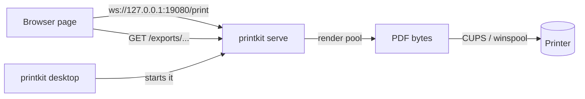

# printkit browser integration guide

A browser page prints by talking to a printkit service on the same machine, and the service prints
through the operating system. The service binds `127.0.0.1` only. Protocol 1, SDK `0.2.7`
(main/0.2.7-dev; latest published release is v0.2.7); contracts:
`schema/document-v1.json` and `schema/protocol-v1.json`. `main` is still pre-1.0,
so methods removed before the first public release (for example `calib.*`) carry no
compatibility shim.

## Contents

- [Who this is for](#who-this-is-for) · [Not for](#not-for)
- [Architecture](#architecture) · [Prerequisites](#prerequisites)
- [5-minute quickstart](#5-minute-quickstart) · [Origin allowlist](#origin-allowlist)
- [Authentication and scopes](#authentication-and-scopes) · [API](#api)
- [Job lifecycle and events](#job-lifecycle-and-events)
- [Capabilities](#capabilities) · [Security and HTTPS](#security-and-https)
- [Troubleshooting](#troubleshooting) · [Non-goals](#non-goals)

## Who this is for

- Pages in the user's own browser: plain HTML/JS, Vue, React, Svelte, Angular, server-rendered HTML
  the browser then loads, or an Electron/Tauri WebView.
- Documents, tickets, receipts and reports printed from data the page already holds, plus preview and
  PDF export.

The hard requirement: the code runs where `127.0.0.1` is the user's computer and can open a WebSocket
to it.

## Not for

- A server, SSR process or backend queue: there `127.0.0.1` is the server, so it cannot reach the
  user's printer.
- LAN, public-network or cloud printing: no remote bind, no TLS listener.
- Multi-tenant trust. Origin management is a single-machine panel in the desktop app's Settings,
  not a multi-tenant admin console.

## Architecture



- **hello:** the page opens the socket and sends `hello` with protocol, SDK name and
  `location.origin`; the service checks `Origin` and answers `welcome` or `rejected`.
- **Request/response:** `{id, method, params}` gets `{id, ok, result|error, warnings}` with the same
  `id`; one socket carries any number of requests.
- **Job event:** `doc.print` returns a `jobId` at once; status changes arrive as
  `{type:"event", event:"job"}` frames until the job is `done` or `failed`.
- **Export:** `doc.exportPdf` writes under `<data_dir>/exports/`; a page cannot open `file://`, so it
  uses the signed `GET /exports/<path>?exp=…&sig=…` capability URL returned in `doc.exportPdf`.

## Prerequisites

1. Install and launch printkit desktop: it starts the service, owns the data directory and allows one
   instance. `printkit serve` from the CLI archive does the same. macOS 11+ on Apple silicon is the
   verified target; Windows is covered under [Capabilities](#capabilities).
2. Check that it answers `200`:
   ```sh
   curl -s -o /dev/null -w '%{http_code}\n' http://127.0.0.1:19080/admin/session
   ```
3. Confirm the port: `19080` is the default, `serve` records what it bound in
   `<data_dir>/serve.lock`, and `printkit config --json` shows the configured value. Register the
   page origin too; an unlisted one fails the handshake with `E_ORIGIN`.

Below, `printkit` means the CLI binary or the desktop's sidecar.

## 5-minute quickstart

### With the TypeScript SDK

`dist/` is not committed: build it in the printkit repository, then install the package into the page
project by path.

```sh
pnpm --dir packages/sdk-ts build
pnpm add /path/to/printkit/packages/sdk-ts
```

```ts
import { createEngine } from "@printkit/sdk";

// No token: a whitelisted origin receives the print scope.
const engine = await createEngine({ origin: location.origin });
const { jobId } = await engine.print(document);

engine.onJob((event) => console.log(jobId, event.status));
```

Defaults are `ws://127.0.0.1:19080/print` and a 5 s connect timeout. Per-call timeouts are 30 s
for `print` / `sendRaw` and 120 s for `exportPdf` / `previewPage`; pass `timeoutMs` to override,
or set `requestTimeoutMs` when creating the engine. `createEngine` sends `hello` then `sys.info`,
so `engine.ui` works before the first render. The SDK never reconnects implicitly: after a stopped
service every call rejects with `E_CONNECT`; call `engine.reconnect()` (or build a new engine)
when the page is shown again. A local timeout does not cancel server-side rendering.

### With plain WebSocket

No dependency, the protocol directly. This snippet has no per-request timeout and no reconnect, so
add what the page needs. The SDK ships the per-method timeouts above but never reconnects
implicitly; after a failure, call `reconnect()` or `createEngine`.

```js
const socket = new WebSocket("ws://127.0.0.1:19080/print");
const pending = new Map();
let nextId = 1;

const ready = new Promise((resolve, reject) => {
  socket.onopen = () => socket.send(JSON.stringify({ type: "hello", protocol: 1, sdk: "my-page", origin: location.origin }));
  socket.onerror = () => reject(new Error("E_CONNECT: unreachable"));
  socket.onmessage = ({ data }) => {
    const frame = JSON.parse(data);
    if (frame.type === "welcome") resolve(frame);
    else if (frame.type === "rejected") reject(Object.assign(new Error(frame.error.message), frame.error));
    else if (frame.type === "event") console.log(frame.jobId, frame.status);
    else pending.get(frame.id)?.settle(frame);
  };
});

const request = (method, params = {}) =>
  new Promise((resolve, reject) => {
    const id = String(nextId++);
    pending.set(id, { settle: (f) => { pending.delete(id); f.ok ? resolve(f.result) : reject(Object.assign(new Error(f.error.message), f.error)); } });
    socket.send(JSON.stringify({ id, method, params }));
  });

const welcome = await ready; // { protocol, engine, granted, capabilities, pluginFamilies, warnings }
const { jobId } = await request("doc.print", document);
```

Send only `hello` and `{id, method, params}`; `welcome` and `rejected` are the only frames the service
pushes before a request is answered.

### Print one document

Both paths take the same object; lengths are millimetres and `pages` is the print order.

```json
{
  "version": 1,
  "pages": [{
    "spec": { "size": "custom", "width": 40, "height": 40, "margins": { "top": 2, "right": 2, "bottom": 2, "left": 2 } },
    "items": [{ "id": "qr", "type": "barcode", "frame": { "x": 2, "y": 2, "width": 36, "height": 36 }, "style": { "quietZone": 1 }, "data": { "kind": "qr", "value": "https://app.example/item/42" } }]
  }]
}
```

`spec.size` is `A3`, `A4`, `A5`, `Letter` or `custom` (then `width` and `height` are required);
margins default to `0`. Items are `text`, `html`, `table`, `barcode`, `image`, `pdf` or `shape`, each
needs `id`, `type`, `frame` and `data`, and array order is z-order. `output.printer.name` defaults to
the system printer, `copies` is 1–999 and `collate` defaults to `true`.

`spec.margins` pads page content and the continuation of `table` rows. Absolute
`frame` coordinates for other items are relative to the full page and are not
shifted by margins.

v1 has no page-range selection and does not show a system print dialog.

## Origin allowlist

The service compares the browser's `Origin` header by exact string before it looks at any token.

- Format `scheme://host[:port]`, for example `http://localhost:3101` or `https://app.example`; a
  non-default port must be written. No path, query, fragment, credentials or wildcard, and an IPv6
  host is bracketed as in `http://[::1]:5173`.
- Every client, port and environment needs its own entry: `http://localhost:5173` and
  `http://127.0.0.1:5173` differ.
- `http://127.0.0.1:<port>` and `http://localhost:<port>` are reserved admin origins and cannot be
  added as business origins.

Add or remove origins in the desktop app under **Settings → Web access**. When the service was
started outside the shell, that list is read-only. The loopback JSON API below remains available for
scripts; the admin token is `<data dir>/admin-token`, mode 0600.

```sh
base=http://127.0.0.1:19080; jar=$(mktemp); curl -s -c "$jar" -o /dev/null "$base/admin/session"; csrf=$(awk '$6=="pk_csrf"{print $7}' "$jar")
curl -s -b "$jar" -c "$jar" -H "Origin: $base" -H "X-CSRF-Token: $csrf" -H 'Content-Type: application/json' -d "{\"token\":\"$(cat "$HOME/Library/Application Support/printkit/admin-token")\"}" "$base/admin/login"
curl -s -b "$jar" -H "Origin: $base" -H "X-CSRF-Token: $csrf" -H 'Content-Type: application/json' -d '{"origin":"http://localhost:5173"}' "$base/admin/origins"
# {"origins":["http://localhost:5173"]}
```

A malformed origin answers `400 E_ORIGIN`; a missing session, a foreign `Origin` or a CSRF mismatch
answers `403`. `DELETE /admin/origins` with `{"origin"}` removes one entry and returns the remaining
list; removing an origin that is not listed succeeds unchanged. `printkit origin list/add/remove`
performs the same calls after validating the live `serve.lock`.

## Authentication and scopes

A whitelisted browser origin, or a local script that sends no `Origin` header, needs no token and
receives `print` only.

| scope | grants | obtained by |
|---|---|---|
| `print` | `sys.info`, `printers.*`, `doc.*`, `preview.*`, `job.*`, plus `records.*` while its plugin is on | no token from a whitelisted origin or a local script |
| `raw` | `raw.send` | `POST /admin/tokens` with `raw: true` |
| `admin` | `trace.*`, `logs.export` | `POST /admin/tokens` with `admin: true` |

The `records.*` methods and `/records/*` HTTP routes are owned by the built-in
`records` plugin; `trace.*` / `logs.export` belong to `observability`. A disabled
plugin removes its methods and routes (they return `E_NOT_FOUND`/404 instead of
empty data). A CLI or `serve` data directory starts with the `core` preset, so
both are off until `printkit plugin enable <id>`; a desktop-owned first start
seeds both enabled and never overwrites an existing `plugins.toml`.

- `POST /admin/tokens` takes `{"origin","raw","admin","nonBrowser"}` and answers `201` with
  `{token, id, origin, scopes, nonBrowser}`; the origin must be allowlisted first, and the desktop app
  issues no tokens. `DELETE /admin/tokens/{id}` (administrator session + CSRF) revokes the row;
  later handshakes get `E_AUTH` and the audit row stays.
- Every WS message and frame is capped at 32 MiB by the transport, so an oversized request closes the connection (observed as an unclean 1006 close) rather than arriving as a reply. `doc.printPdfBatch` also checks the combined base64 payload itself and answers `E_TOO_LARGE` when it is handed a payload over that cap (verified in-process; on a socket the transport rejects it first), so the limit is never silent truncation. Use HTTP `/print/batch` for the 128 MiB PDF path. The unauthenticated first frame is capped at 4 KiB after the upgrade. Pre-auth buffering is bounded by the
  eight-connection limit (8 × 32 MiB); keep that in mind when exposing the service to a shared host.
- A browser token is bound to its origin, and `nonBrowser` tokens only work without an `Origin`
  header. A mismatch is `E_ORIGIN`, an unknown or revoked token `E_AUTH`, and a `hello.origin` that
  differs from the header `E_ORIGIN`.
- `welcome` returns `{protocol, engine, granted, capabilities, pluginFamilies, warnings}`; `granted`
  lists scopes, `pluginFamilies` names the active optional method families (`records`,
  `observability`), and `capabilities` is a legacy compatibility list that the
  server now always sends empty. A refusal is
  `{"type":"rejected","error":{"code","message","detail":{"traceId"}}}`; keep the `traceId` for
  `printkit logs --trace <id>`.

## API

Each wire method takes one parameter object; SDK methods wrap the wire names one-to-one.
The protocol has **21 request methods plus the `hello` handshake** (22 descriptors in
`protocol-v1.json`). Eighteen request methods have SDK wrappers; the three admin observability
methods are wire-only (see below). `createEngine` is the SDK entry for `hello`, so the SDK exposes
19 callables in total.

#### System

| SDK | wire method | notes |
|---|---|---|
| `createEngine` | `hello` | handshake; `welcome` carries `granted`, `capabilities` and `pluginFamilies` |
| `info(refresh?)` | `sys.info` | `{engine, protocol, platform, capabilities}`; cached after the handshake |

#### Documents and printing

| SDK | wire method | notes |
|---|---|---|
| `print(document)` | `doc.print` | returns `{jobId}`; failures surface on the job |
| `printBatch(docs, opts)` | `doc.printBatch` | `docs` is a `Document[]` (1–100); it never carries PDF parts. `printer`, `copies`, `collate` apply once to the merged job; every document must set `output.copies` to 1 (otherwise `E_SCHEMA` with `/documents/{index}/output.copies`); returns `{jobId, docCount, pageCount}`. |
| `printPdf(bytes, opts)` | `doc.printPdf` | base64 PDF, `printer`, `copies`; the bytes are submitted byte-for-byte without rendering; `collate` is always `true` on this method; rejects locally without `pdfPassthrough`; a 0-page PDF is `E_SCHEMA` with `detail.pointer = /pdf/pages` |
| `printPdfBatch(pdfs, opts)` | `doc.printPdfBatch` | `pdfs` are `{bytes(base64), copies?=1}[]` (1–100); top-level `printer`, `copies`, `collate`; one PDF is submitted byte-for-byte, several are merged; per-PDF `copies` must be 1; a merge that drops AcroForm/Outlines/Metadata reports `W_PDF_MERGE_METADATA_LOST` exactly once, on the job's `done` event (the response `warnings` stays empty); returns `{jobId, pages}`. WS messages are capped at 32 MiB (JSON/base64 included), so an oversized frame closes the connection; use HTTP `/print/batch` for the 128 MiB path |
| `exportPdf(document, path)` | `doc.exportPdf` | relative `path`, no `.`/`..`; returns the fields below |

`doc.printBatch` and `POST /print/batch` are different routes. The SDK method accepts documents only. The
HTTP route is `multipart/mixed`: the first part is `application/json` metadata, later parts are
`application/pdf` or `application/json` (a Document). Metadata fields:

| field | type | default | meaning |
|---|---|---|---|
| `printer` | `string?` | system default | destination printer |
| `copies` | `number?` | `1` | 1–999, applied once at the spooler level |
| `collate` | `boolean?` | `true` | `true` collates complete sets; `false` leaves page order to the spooler |

Exactly one metadata part plus exactly one `application/pdf` part is passed through byte-for-byte, and
`copies`/`collate` still reach the spooler. Any other combination is merged into one PDF; several PDF
parts may raise `W_PDF_MERGE_METADATA_LOST` when an input carries AcroForm, outlines or metadata.
The merged path uses one spooler submission. A PDF part error points at `/documents/{index}`.

`doc.exportPdf` result:

| field | type | meaning |
|---|---|---|
| `path` | `string` | relative to the data directory (`exports/...`) |
| `absolutePath` | `string` | canonical file path on the service machine |
| `pages` | `number` | pages in the written PDF |
| `bytes` | `number` | file size |
| `url` | `string?` | signed capability URL for this exact file |
| `expiresAt` | `number?` | Unix seconds after which `url` stops working (10 minutes after the call) |

Open the result only through `url`; an unsigned, expired or wrong-file link is
`403 E_AUTH`. Do not construct or publish a bare `/exports/<path>` URL.

#### Printers

| SDK | wire method | notes |
|---|---|---|
| `listPrinters()` | `printers.list` | `{name, isDefault, duplex, raw, mimeTypes, paperSource}` |
| `paperSizes(name)` | `printers.papers` | parameter `name` |

#### Preview

| SDK | wire method | notes |
|---|---|---|
| `preview(document)` | `doc.preview` | native window, returns `{windowId}`; rejects locally without `preview` |
| `previewPage(windowId, pageIndex, dpi)` | `preview.pages` | `dpi` 72–300; returns `{png}` as base64 |
| `closePreview(windowId)` | `preview.close` | |

#### Jobs

| SDK | wire method | notes |
|---|---|---|
| `jobStatus(jobId)` | `job.status` | `{jobId, status, pages, queuePos, warnings, error}` |
| `cancelJob(jobId)` | `job.cancel` | see [Job lifecycle](#job-lifecycle-and-events) |

Raw jobs: `job.status.pages` is `0`/unknown; the usage row counts one successful
raw submission as one sheet. This is a usage floor, not a fetched page count.

#### Records

| SDK | wire method | notes |
|---|---|---|
| `myRecords(query)` | `records.list` | `from`, `to`, `tags`, `printer`, `status` (`done`, `failed`, `cancelled` or `pending`), `cursor`, `limit`; returns `{records, nextCursor}` |
| `myStats(groupBy, query)` | `records.stats` | same filters plus `groupBy` |
| `mySummary(query)` | `records.summary` | `{todaySheets, todayDone, todayFailed, todayCancelled, total, failed, cancelled, pending, avgDurMs, slowestPrinter?, slowestAvgDurMs}`; `todayDone` is today’s successful print-request count; `done = total-failed-cancelled-pending`; failure rate is `failed/(done+failed)` and excludes cancelled/pending; `pending` is a required window total in v1 (a client built against an older service may read an absent value as 0; no today-specific counterpart field); `todayDoneSheets` is a deprecated compatibility field; same filters; needs the `records` plugin |
| `exportRecords(query)` | `records.export` | `{csv}` with a UTF-8 BOM; the SDK decodes it to bytes. The export is bounded to the newest 5000 rows and written in id order (the default `records.max_rows` retention keeps 5000, so a healthy table is exported whole) |

Records are filtered by the session's origin on the service, not by the page.

#### Admin observability (wire-only)

These three methods need the `admin` scope and the `observability` plugin; the SDK does not wrap
them, so call them with a request envelope yourself. They are part of the 21 request-method count.

| wire method | params | result | notes |
|---|---|---|---|
| `trace.subscribe` | `stages?`, `since?` | streamed `trace` events | one subscription per connection; `since` is the last seq |
| `trace.tail` | `traceId` | `{events: TraceEventView[]}` | one job timeline |
| `logs.export` | `from?`, `to?` | `{path, bytes}` | redacted diagnostics archive, path relative to the data directory |

#### Raw

| SDK | wire method | notes |
|---|---|---|
| `sendRaw(printer, bytes)` | `raw.send` | base64 device bytes; needs the `raw` scope |

### Idempotency

Duplicate suppression is best-effort, not a delivery guarantee. `doc.print`, `doc.printBatch`,
`doc.printPdf`, `doc.printPdfBatch` and `raw.send` accept `requestId`; `POST /print/batch` accepts `Idempotency-Key`.
Keys are namespaced by transport, method and origin and remembered for at most 600 seconds, 1024
entries and about 1 MiB in one service process. A duplicate inside that budget returns the original
job id without reserving or printing again. After the window, after an eviction, or after a service
restart the same key starts a new job and prints again. When a repeated sheet is unacceptable, keep
your own business id and reconcile returned job ids instead of relying on this cache.

### Errors

Failures carry `{code, message, detail}`; `detail` is free form, and for `E_SCHEMA` it holds
`detail.pointer`, a JSON pointer into the document.

| code | meaning |
|---|---|
| `E_CONNECT` | service down or unreachable; raised by the client, not the service |
| `E_AUTH` | token unknown, revoked, or missing a scope |
| `E_ORIGIN` | origin not allowlisted, token bound elsewhere, or `hello.origin` differs from the header |
| `E_CSRF` | missing or mismatched `X-CSRF-Token` on a mutating `/admin` request |
| `E_SCHEMA` | validation failed; read `detail.pointer` |
| `E_PROTOCOL` | protocol mismatch or an incomplete `hello` |
| `E_PRINTER_NOT_FOUND` | no printer carries that name |
| `E_PAPER_UNSUPPORTED` | the driver rejects the paper size |
| `E_JOB_FAILED` | render or print failed; `detail` carries the platform status |
| `E_TIMEOUT` | the queue or one request timed out |
| `E_UNSUPPORTED` | the build lacks the capability, or policy refuses it (duplex today) |
| `E_CANCEL_UNSUPPORTED` | already submitted, and this platform cannot retract it |
| `E_RAW_UNSUPPORTED` | the printer or driver does not take raw bytes |
| `E_PDF_ENCRYPTED` | the embedded PDF is password protected |
| `E_NOT_FOUND` | unknown `jobId` or `windowId`, or a finished job |
| `E_TOO_LARGE` | a runtime limit that shrinking the request clears |
| `E_RENDER_CRASH` | the renderer process crashed |

A 0-page PDF (single or batch) is rejected with `E_SCHEMA`; an empty PDF is never submitted. macOS printer discovery lists only submit-capable cupsd queues and does not fall back to PrintCore-only names.

`E_ALREADY_RUNNING` is a `serve` startup error, not a page error. Never fall back to another print
path silently: a retry can print the same job twice.

## Job lifecycle and events

`doc.print`, `doc.printBatch`, `doc.printPdf`, `doc.printPdfBatch` and `raw.send` answer with a `jobId` immediately and
report failures on the job, not on the reply.

```text
queued ──► printing ──► done
   │            └──────► failed
   └───────────────────► cancelled
```

```json
{"type":"event","event":"job","jobId":"01J8Z0...","status":"queued","queuePos":1}
{"type":"event","event":"job","jobId":"01J8Z0...","status":"printing"}
{"type":"event","event":"job","jobId":"01J8Z0...","status":"failed","error":{"code":"E_PRINTER_NOT_FOUND","message":"printer not found: No Such Printer"}}
```

- `queuePos` only appears while `queued`, `warnings` only on a `done` that raised some, and `error`
  only on `failed`. `progress` is optional in the contract; this build reports status changes.
- A batch that rebuilds several PDFs raises `W_PDF_MERGE_METADATA_LOST` when an input carried
  AcroForm, Outlines or Metadata: page content is preserved, but those structures do not survive
  the merge. This warning is reported once per job, not once per PDF part.
- Events reach the sockets sharing the job's origin, and a job belongs to the origin that started it:
  `job.status` and `job.cancel` answer `E_NOT_FOUND` from another origin or for a finished job.
- `job.cancel` always cancels a queued job and emits a `cancelled` event; a job already handed to the
  print system is retracted only where `cancelSubmitted` (graphic/PDF) or `cancelRaw` (raw bytes) is
  true, otherwise `E_CANCEL_UNSUPPORTED`. On Windows, PDF and batch jobs go through the WebView2
  viewer, carry no spooler id and are never cancellable.
- `done` means the document reached the print path, not that paper came out. Events are not replayed:
  after a restart, build a new engine and poll `job.status`.

## Capabilities

`sys.info.capabilities` describes what this build does, not what the platform could do. Hide a control
when its bit is false; never branch on `platform`.

| capability | effect when false | current value |
|---|---|---|
| `duplex` | no duplex option | `false` everywhere: no duplex device is verified, so a duplex request is `E_UNSUPPORTED` |
| `paperSource` | no tray selector | `false`: version 1 only accepts `paperSource: null` |
| `cancelSubmitted` | hide cancelling a submitted graphic/PDF job | `true` on macOS, `false` on Windows |
| `cancelRaw` | hide cancelling a submitted raw job | `true` |
| `preview` | hide the preview entry, fall back to `exportPdf` | `true` (macOS verified, Windows unverified) |
| `rasterFallback` | no raster fallback entry | `false` |
| `raw` | hide the raw channel | `true` (Windows unverified) |
| `batch` | hide batch printing | `true` (Windows unverified) |
| `pdfPassthrough` | hide PDF printing | `true` (Windows unverified) |
| `renderWorkers` | — | actual render parallelism |

`welcome.pluginFamilies` is the list to read for optional methods: it names the active plugin ids
(`records`, `observability`), and a page must hide a plugin-owned entry when its id is
absent. `welcome.capabilities` is kept only for clients that predate plugin ids and is empty;
`CapabilityFamily::Template` exists only so an old `welcome` frame can still be parsed; this
server never sends it.

`printPdf` and `preview` refuse locally with `E_UNSUPPORTED` when their runtime bit is false, so the
page never sends a request the service would reject.

Windows: the workflow builds unsigned NSIS and MSI installers, but no release containing them has been
installed on a real Windows host. Graphic printing, preview capture, raw output and printing on
hardware are unverified. `doc.printPdf` and `doc.printBatch` hand the PDF to the WebView2 viewer, with
no spooler id and no cancellation; mixed-paper documents are rendered page by page and concatenated,
also unverified. Duplex is still refused. Preview windows have Print and Ctrl+P but no page or zoom
controls, and the build needs WebView2 Runtime 1.0.1518.46 or newer. On macOS a preview window pages
and zooms before printing, and `preview.pages` returns any page as PNG at the requested DPI.

## Security and HTTPS

- The service binds `127.0.0.1` only. Never expose, tunnel or reverse-proxy the port; every protection
  below assumes a loopback peer.
- An `https://` page can open `ws://127.0.0.1:<port>` in Chrome, which treats loopback as trustworthy;
  that was verified with an installed build. Safari, Firefox, enterprise proxies and Chrome Private
  Network Access are untested. If a browser blocks it, terminate TLS locally and use `wss`.
- WebSocket handshakes skip the CORS preflight, but the `Origin` allowlist and a bound token still stop
  a hostile page. Register only origins you control, and allow `ws://127.0.0.1:19080` in `connect-src`
  plus the export URL if the page has a CSP.
- `GET /exports/...` requires a loopback `Host`, confines the canonical path to `<data_dir>/exports/`,
  rejects traversal/absolute paths/escaping symlinks, and verifies a per-run HMAC over the canonical
  file path plus a 10-minute expiry (`exp`, `sig`). `doc.exportPdf` returns this URL in `url` and its
  deadline in `expiresAt`. An unsigned, expired or wrong-file link is `403 E_AUTH`; the signature is
  the capability, so a path alone is never enough. Do not construct or publish a bare
  `/exports/<path>` URL.
  Errors on this route (400/403/404/500) are `application/json; charset=utf-8` with
  `{ok:false,error:{code,message}}`; only a successful read is the binary PDF.

## Troubleshooting

The `printkit logs` checks below need the `observability` plugin; under the
default `core` preset run `printkit plugin enable observability` (service
running) first, otherwise the command exits with that hint. `printkit stats`
needs `records` in the same way.

| symptom | check |
|---|---|
| `E_CONNECT` on every call | `curl -s -o /dev/null -w '%{http_code}\n' http://127.0.0.1:19080/admin/session` must print `200` |
| Wrong port, or a stale service | `printkit config --json` shows `data_dir` and `server.port`; the port bound is in `serve.lock` there |
| `E_ORIGIN` | `printkit logs --json --stage auth --since 1h` shows the failing handshake and its origin |
| `E_AUTH` | `printkit logs --json --trace <traceId>` for that refusal; re-issue the token for the exact origin |
| Blank or shifted print | `printkit papers --printer "Your Printer" --json` and compare the document's millimetres |
| Missing glyphs | `printkit logs --json --stage render` and look for `W_MISSING_GLYPH` |
| PDF tab `400` or `403` | `403` means a foreign `Host`, or a link whose `exp`/`sig` is missing, expired or not bound to that file; `400` is a bad path |
| Second instance refuses to start | `printkit serve` prints `[E_ALREADY_RUNNING]` with the owning pid and port |
| Windows: nothing renders | `printkit doctor --json` reports `webview.available` and `webview.version` |
| Nothing happens under Safari or Firefox | `printkit logs --json --stage auth` shows no handshake: the browser never opened the socket |

## Non-goals

- A LAN, public or cloud print service.
- A browserless server-side print API.
- Multi-tenancy, accounts or a shared queue.
- An HTTP/CORS browser print entry; browsers use the WebSocket. `POST /print/batch` is a script-facing multipart route with no CORS response headers.
- A desktop UI for tokens or origins, or a browser-based plugin administration page.
