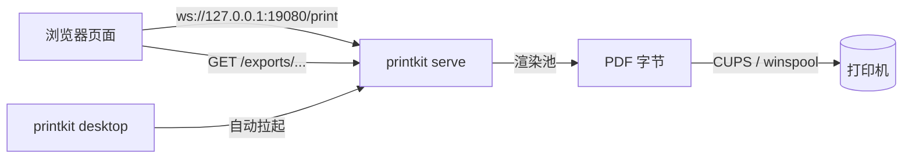

# printkit 浏览器接入指南

浏览器页面通过本机的 printkit 服务打印，服务再把文档交给操作系统。服务只绑定 `127.0.0.1`。
protocol 1、SDK `0.2.1`；契约文件为 `schema/document-v1.json` 与 `schema/protocol-v1.json`。
`0.2.1` 仍是 1.0 之前的版本，因此首次公开发布前删除的方法（如 `calib.*`）不提供兼容层。

## 目录

- [适用场景](#适用场景) · [不适用](#不适用)
- [架构](#架构) · [前置条件](#前置条件)
- [五分钟快速上手](#五分钟快速上手) · [Origin 白名单](#origin-白名单)
- [鉴权与 scope](#鉴权与-scope) · [API](#api)
- [任务生命周期与事件](#任务生命周期与事件)
- [能力协商](#能力协商) · [安全与 HTTPS](#安全与-https)
- [排错](#排错) · [非目标](#非目标)

## 适用场景

- 运行在用户自己浏览器里的页面：纯 HTML/JS、Vue、React、Svelte、Angular、后端渲染后由浏览器加载
  的 HTML，或 Electron/Tauri 的 WebView。
- 用页面已有数据打印文档、小票、收据、报表，以及预览和导出 PDF。

硬前提：代码运行的环境里 `127.0.0.1` 是用户自己的电脑，并且能建立 WebSocket 连接。

## 不适用

- 服务端、SSR 进程或后端队列：那里的 `127.0.0.1` 是服务器，够不到用户的打印机。
- 局域网、公网、云打印：服务没有远程监听，也没有 TLS 监听。
- 多租户信任。Origin 管理是桌面应用 Settings 里的单机面板，不是多租户管理台。

## 架构



- **hello：** 页面建立连接后发送 `hello`，带上 protocol、SDK 名称和 `location.origin`；服务校验
  `Origin`，回 `welcome` 或 `rejected`。
- **请求/响应：** `{id, method, params}` 对应 `{id, ok, result|error, warnings}`，`id` 相同；一条
  连接可以承载任意多个请求。
- **任务事件：** `doc.print` 立即返回 `jobId`，状态变化以 `{type:"event", event:"job"}` 帧推送，
  直到 `done` 或 `failed`。
- **导出：** `doc.exportPdf` 写入 `<data_dir>/exports/`；页面打不开 `file://`，改用 `doc.exportPdf` 返回的签名链接
  `GET /exports/<path>?exp=…&sig=…`。

## 前置条件

1. 安装并启动 printkit desktop：它拉起服务、独占数据目录，并且只允许一个实例；用 CLI 包里的
   `printkit serve` 效果相同。已验证的目标平台是 macOS 11+ 的 Apple 芯片机器；Windows 见
   [能力协商](#能力协商)。
2. 确认服务返回 `200`：
   ```sh
   curl -s -o /dev/null -w '%{http_code}\n' http://127.0.0.1:19080/admin/session
   ```
3. 确认端口：`19080` 是默认值，`serve` 会把实际绑定的端口写进 `<data_dir>/serve.lock`，
   `printkit config --json` 显示配置值。同时登记页面 Origin；未登记的 Origin 在握手阶段报
   `E_ORIGIN`。

下文中的 `printkit` 指 CLI 可执行文件，或桌面应用内置的 sidecar。

## 五分钟快速上手

### 使用 TypeScript SDK

`dist/` 不进版本库：先在 printkit 仓库构建，再按路径把包装进页面工程。

```sh
pnpm --dir packages/sdk-ts build
pnpm add /path/to/printkit/packages/sdk-ts
```

```ts
import { createEngine } from "@printkit/sdk";

// 不带令牌：已登记 Origin 的页面拿到 print scope。
const engine = await createEngine({ origin: location.origin });
const { jobId } = await engine.print(document);

engine.onJob((event) => console.log(jobId, event.status));
```

默认地址 `ws://127.0.0.1:19080/print`、连接超时 5 秒。单次调用超时：`print` / `sendRaw`
30 秒，`exportPdf` / `previewPage` 120 秒；可传 `timeoutMs` 覆盖，或在创建 engine 时设
`requestTimeoutMs`。`createEngine` 先发 `hello` 再发 `sys.info`，所以首次渲染前就能用
`engine.ui`。SDK 不做隐式重连：服务停止后每次调用都以 `E_CONNECT` 拒绝，页面重新显示时应调用
`engine.reconnect()` 或新建 engine。本地超时不会取消服务端渲染。

`print`、`printBatch`、`printPdf`、`printPdfBatch`、`sendRaw` 接受 `requestId`；HTTP
`POST /print/batch` 接受 `Idempotency-Key`。去重是尽力而为（见下文「幂等」），不保证绝不重复打印。

### 使用原生 WebSocket

零依赖，直接讲协议。下面的片段既没有单请求超时也不会重连，按页面需要自行补齐。SDK 自带上述按方法
超时，但同样不隐式重连：失败后调用 `reconnect()` 或重新 `createEngine`。

```js
const socket = new WebSocket("ws://127.0.0.1:19080/print");
const pending = new Map();
let nextId = 1;

const ready = new Promise((resolve, reject) => {
  socket.onopen = () => socket.send(JSON.stringify({ type: "hello", protocol: 1, sdk: "my-page", origin: location.origin }));
  socket.onerror = () => reject(new Error("E_CONNECT: unreachable"));
  socket.onmessage = ({ data }) => {
    const frame = JSON.parse(data);
    if (frame.type === "welcome") resolve(frame);
    else if (frame.type === "rejected") reject(Object.assign(new Error(frame.error.message), frame.error));
    else if (frame.type === "event") console.log(frame.jobId, frame.status);
    else pending.get(frame.id)?.settle(frame);
  };
});

const request = (method, params = {}) =>
  new Promise((resolve, reject) => {
    const id = String(nextId++);
    pending.set(id, { settle: (f) => { pending.delete(id); f.ok ? resolve(f.result) : reject(Object.assign(new Error(f.error.message), f.error)); } });
    socket.send(JSON.stringify({ id, method, params }));
  });

const welcome = await ready; // { protocol, engine, granted, capabilities, pluginFamilies, warnings }
const { jobId } = await request("doc.print", document);
```

只发送 `hello` 和 `{id, method, params}`；服务在应答请求之前只会主动推送 `welcome` 和 `rejected`。

### 打印一个文档

两条路径用同一个对象；长度单位是毫米，`pages` 就是打印顺序。

```json
{
  "version": 1,
  "pages": [{
    "spec": { "size": "custom", "width": 40, "height": 40, "margins": { "top": 2, "right": 2, "bottom": 2, "left": 2 } },
    "items": [{ "id": "qr", "type": "barcode", "frame": { "x": 2, "y": 2, "width": 36, "height": 36 }, "style": { "quietZone": 1 }, "data": { "kind": "qr", "value": "https://app.example/item/42" } }]
  }]
}
```

`spec.size` 取 `A3`、`A4`、`A5`、`Letter` 或 `custom`（后者必须给 `width` 和 `height`）；页边距默认
`0`。元素类型为 `text`、`html`、`table`、`barcode`、`image`、`pdf`、`shape`，每个都要 `id`、
`type`、`frame`、`data`，数组顺序即 z-order。`output.printer.name` 默认系统打印机，`copies` 范围
1–999，`collate` 默认 `true`。

`spec.margins` 为页面内容与 `table` 续表提供内边距；其他元素的绝对 `frame` 坐标
仍相对整页，不会被 margins 平移。

v1 不支持页范围选择，也不弹系统打印对话框。

## Origin 白名单

服务在检查任何令牌之前，先用精确字符串比较浏览器发来的 `Origin` 头。

- 格式 `scheme://host[:port]`，例如 `http://localhost:3101` 或 `https://app.example`；非默认端口
  必须写出来。不能带路径、查询、片段、凭据或通配符，IPv6 主机加方括号，如 `http://[::1]:5173`。
- 每个客户端、每个端口、每套环境单独登记：`http://localhost:5173` 与
  `http://127.0.0.1:5173` 是两条。
- `http://127.0.0.1:<port>` 和 `http://localhost:<port>` 是保留的管理 Origin，不能当作业务
  Origin 登记。

在桌面应用 **Settings → Web 访问** 中添加或移除 Origin；服务由桌面壳之外启动时，该列表为
只读。脚本仍可使用下面的回环 JSON API；管理令牌是 `<数据目录>/admin-token`，权限 0600。

```sh
base=http://127.0.0.1:19080; jar=$(mktemp); curl -s -c "$jar" -o /dev/null "$base/admin/session"; csrf=$(awk '$6=="pk_csrf"{print $7}' "$jar")
curl -s -b "$jar" -c "$jar" -H "Origin: $base" -H "X-CSRF-Token: $csrf" -H 'Content-Type: application/json' -d "{\"token\":\"$(cat "$HOME/Library/Application Support/printkit/admin-token")\"}" "$base/admin/login"
curl -s -b "$jar" -H "Origin: $base" -H "X-CSRF-Token: $csrf" -H 'Content-Type: application/json' -d '{"origin":"http://localhost:5173"}' "$base/admin/origins"
# {"origins":["http://localhost:5173"]}
```

格式非法的 Origin 返回 `400 E_ORIGIN`；缺少会话、`Origin` 不属于管理端或 CSRF 不匹配返回 `403`。

## 鉴权与 scope

已登记 Origin 的浏览器页面，或不带 `Origin` 头的本机脚本，不需要令牌，只拿到 `print`。

| scope | 授予 | 获取方式 |
|---|---|---|
| `print` | `sys.info`、`printers.*`、`doc.*`、`preview.*`、`job.*`，以及对应插件开启时的 `records.*` | 已登记 Origin 或本机脚本不带令牌 |
| `raw` | `raw.send` | `POST /admin/tokens` 且 `raw: true` |
| `admin` | `trace.*`、`logs.export` | `POST /admin/tokens` 且 `admin: true` |

`records.*` 方法与 `/records/*` 路由归内置 `records` 插件；`trace.*` / `logs.export` 归
`observability`。插件关闭后对应方法与路由消失（返回 `E_NOT_FOUND`/404，而不是空数据）。
CLI 或 `serve` 的数据目录为 `core` preset，两者默认关闭，需用
`printkit plugin enable <id>` 打开；桌面应用首次自建启动时两个插件均已启用，
且不覆盖已存在的 `plugins.toml`。

- `POST /admin/tokens` 接收 `{"origin","raw","admin","nonBrowser"}`，返回 `201` 与
  `{token, id, origin, scopes, nonBrowser}`；Origin 必须先登记，桌面端不签发令牌。
  `DELETE /admin/tokens/{id}`（管理员会话 + CSRF）撤销该行；之后的握手返回 `E_AUTH`，审计行保留。
- WS 单条消息/单帧上限 32 MiB（JSON/base64 计入），超限请求会被传输层直接断开（实测为 1006 非正常关闭），不会作为响应返回。`doc.printPdfBatch` 自身也会检查合并 base64 载荷，超限时返回 `E_TOO_LARGE`（仅进程内可测；真实连接上传输层先拒绝），因此不存在静默截断。128 MiB 的 PDF 批量走 HTTP `/print/batch`。升级后未认证首帧上限为 4 KiB；认证前缓冲
  受八连接上限约束（8 × 32 MiB）。
- 浏览器令牌绑定签发时的 Origin，`nonBrowser` 令牌只能在不带 `Origin` 头时使用。不匹配报
  `E_ORIGIN`，未知或已撤销的令牌报 `E_AUTH`，`hello.origin` 与传输头不一致同样报 `E_ORIGIN`。
- `welcome` 返回 `{protocol, engine, granted, capabilities, pluginFamilies, warnings}`；`granted` 是
  scope 列表，`pluginFamilies` 列出已启用的可选方法族（`records`、`observability`），
  `capabilities` 仅为旧客户端兼容而保留，服务端现在恒为空。被拒绝时收到
  `{"type":"rejected","error":{"code","message","detail":{"traceId"}}}`，把 `traceId` 留给
  `printkit logs --trace <id>`。

## API

每个协议方法接收一个参数对象；SDK 方法是协议方法的薄封装。协议共 **21 个请求方法 + `hello` 握手**
（`protocol-v1.json` 里 22 条 descriptor）：18 个请求方法有 SDK 封装，3 个 admin 可观测方法只在协议层；`createEngine` 是 `hello` 的 SDK 入口，SDK 共 19 个可调用项。

#### 系统

| SDK 方法 | 协议方法 | 说明 |
|---|---|---|
| `createEngine` | `hello` | 握手；`welcome` 带 `granted`、`capabilities` 与 `pluginFamilies` |
| `info(refresh?)` | `sys.info` | `{engine, protocol, platform, capabilities}`；握手后缓存 |

#### 文档与打印

| SDK 方法 | 协议方法 | 说明 |
|---|---|---|
| `print(document)` | `doc.print` | 返回 `{jobId}`；失败会在任务上体现 |
| `printBatch(docs, opts)` | `doc.printBatch` | `docs` 是 `Document[]`（1–100），**不接收 PDF part**；`printer`、`copies`、`collate` 只作用于合并后的任务；每份文档必须把 `output.copies` 设为 1，否则 `E_SCHEMA` + `/documents/{index}/output/copies`；返回 `{jobId, docCount, pageCount}` |
| `printPdf(bytes, opts)` | `doc.printPdf` | base64 PDF、`printer`、`copies`；字节不渲染、原样提交；该方法的 `collate` 恒为 `true`；没有 `pdfPassthrough` 时本地直接拒绝；0 页 PDF 为 `E_SCHEMA` + `/pdf/pages` |
| `printPdfBatch(pdfs, opts)` | `doc.printPdfBatch` | `pdfs` 为 `{bytes(base64), copies?=1}`（1–100）；顶层 `printer`、`copies`、`collate`；单 PDF 原字节直通，多 PDF 合并；丢失 AcroForm/Outlines/Metadata 时在任务的 `done` 事件返回一次 `W_PDF_MERGE_METADATA_LOST`（response 的 `warnings` 为空）；返回 `{jobId, pages}`；每个 PDF 的 `copies` 必须为 1。WS 单条消息上限 32 MiB（含 JSON/base64），超限帧会被传输层断开；128 MiB 请走 HTTP `/print/batch` |
| `exportPdf(document, path)` | `doc.exportPdf` | `path` 相对路径，不含 `.`/`..`；返回下表字段 |

`doc.printBatch` 与 `POST /print/batch` 是两条不同入口；前者只收文档。HTTP 路由是
`multipart/mixed`：第一段为 `application/json` 元数据，后续段为 `application/pdf` 或
`application/json`（Document）。元数据字段：

| 字段 | 类型 | 默认 | 含义 |
|---|---|---|---|
| `printer` | `string?` | 系统默认 | 目标打印机 |
| `copies` | `number?` | `1` | 1–999，只作为 spooler 份数应用一次 |
| `collate` | `boolean?` | `true` | `true` 逐份；`false` 由 spooler 按页序处理 |

“一个元数据段 + 恰好一个 `application/pdf` 段”原字节直通，`copies`/`collate` 仍生效。其余组合会合并成
一份 PDF；多个 PDF 段在输入带 AcroForm、outline 或 metadata 时可能报 `W_PDF_MERGE_METADATA_LOST`。
合并路径只向 spooler 提交一次；PDF 段错误指向 `/documents/{index}`。

`doc.exportPdf` 结果：

| 字段 | 类型 | 含义 |
|---|---|---|
| `path` | `string` | 相对数据目录的路径（`exports/...`） |
| `absolutePath` | `string` | 服务机上的规范化绝对路径 |
| `pages` | `number` | 写出 PDF 的页数 |
| `bytes` | `number` | 文件字节数 |
| `url` | `string?` | 绑定该文件的签名 capability URL |
| `expiresAt` | `number?` | `url` 失效的 Unix 秒（调用后 10 分钟） |

只能通过 `url` 打开结果；未签名、已过期或与文件不匹配的链接返回
`403 E_AUTH`。不要构造或公开裸 `/exports/<path>` URL。

#### 打印机

| SDK 方法 | 协议方法 | 说明 |
|---|---|---|
| `listPrinters()` | `printers.list` | `{name, isDefault, duplex, raw, mimeTypes, paperSource}` |
| `paperSizes(name)` | `printers.papers` | 参数 `name` |

#### 预览

| SDK 方法 | 协议方法 | 说明 |
|---|---|---|
| `preview(document)` | `doc.preview` | 打开原生窗口，返回 `{windowId}`；没有 `preview` 时本地直接拒绝 |
| `previewPage(windowId, pageIndex, dpi)` | `preview.pages` | `dpi` 72–300；返回 base64 的 `{png}` |
| `closePreview(windowId)` | `preview.close` | |

#### 任务

| SDK 方法 | 协议方法 | 说明 |
|---|---|---|
| `jobStatus(jobId)` | `job.status` | `{jobId, status, pages, queuePos, warnings, error}` |
| `cancelJob(jobId)` | `job.cancel` | 见 [任务生命周期](#任务生命周期与事件) |

raw 任务：`job.status.pages` 为 `0`/未知；usage 行把一次成功的 raw 提交计为 1 sheet；
这是统计下限，不是协议解析出的页数。

#### 记录

| SDK 方法 | 协议方法 | 说明 |
|---|---|---|
| `myRecords(query)` | `records.list` | 过滤 `from`、`to`、`tags`、`printer`、`status`（`done`/`failed`/`cancelled`/`pending`）、`cursor`、`limit`；返回 `{records, nextCursor}` |
| `myStats(groupBy, query)` | `records.stats` | 同样的过滤条件加 `groupBy` |
| `mySummary(query)` | `records.summary` | `{todaySheets, todayDone, todayFailed, todayCancelled, total, failed, cancelled, pending, avgDurMs, slowestPrinter?, slowestAvgDurMs}`；`todayDone` 是今日成功打印请求数；`完成 = 总数-失败-取消-待处理`；失败率 `失败/(完成+失败)`，不含取消/待处理；`pending` 是窗口总数（v1 必填；旧服务若缺失，客户端可按 0 读取），没有今日同名字段；`todayDoneSheets` 是兼容字段；同样的过滤条件；需要 `records` 插件 |
| `exportRecords(query)` | `records.export` | `{csv}`，带 UTF-8 BOM；SDK 转成字节 |

记录由服务按会话 Origin 过滤，不靠页面自己筛。

#### admin 可观测（仅协议层）

这三个方法需要 `admin` scope 与 `observability` 插件；SDK 不封装，需直接发请求信封。它们计入
21 个请求方法。

| 协议方法 | 参数 | 返回 | 说明 |
|---|---|---|---|
| `trace.subscribe` | `stages?`、`since?` | 流式 `trace` 事件 | 每连接一个订阅；`since` 为最后 seq |
| `trace.tail` | `traceId` | `{events: TraceEventView[]}` | 一次打印的时间线 |
| `logs.export` | `from?`、`to?` | `{path, bytes}` | 脱敏诊断包，路径相对数据目录 |

#### raw

| SDK 方法 | 协议方法 | 说明 |
|---|---|---|
| `sendRaw(printer, bytes)` | `raw.send` | base64 设备字节；需要 `raw` scope |

### 幂等

去重是尽力而为，不是投递保证。`doc.print`、`doc.printBatch`、`doc.printPdf`、`raw.send` 接受
`requestId`；`POST /print/batch` 接受 `Idempotency-Key`。键按传输、方法和 Origin 分命名空间，
单个服务进程最多记住 600 秒、1024 条、约 1 MiB。在此预算内重复调用返回原作业，不会再次打印；
超过窗口、被缓存逐出或服务重启后，同一键会创建新作业并再次打印。若重复纸张不可接受，请保留自己的
业务 id 并核对返回的 jobId，不要依赖此缓存。

### 错误码

失败体为 `{code, message, detail}`；`detail` 自由格式，`E_SCHEMA` 时其中带 `detail.pointer`，指向文档
内部的 JSON 指针。

| 错误码 | 含义 |
|---|---|
| `E_CONNECT` | 服务未运行或不可达；由客户端抛出，不是服务返回 |
| `E_AUTH` | 令牌未知、已撤销或缺少所需 scope |
| `E_ORIGIN` | Origin 未登记、令牌绑定在别的 Origin，或 `hello.origin` 与头不一致 |
| `E_CSRF` | 改变状态的 `/admin` 请求缺少或不匹配 `X-CSRF-Token` |
| `E_SCHEMA` | 校验失败；读 `detail.pointer` |
| `E_PROTOCOL` | 协议版本不匹配，或 `hello` 不完整 |
| `E_PRINTER_NOT_FOUND` | 没有这个名称的打印机 |
| `E_PAPER_UNSUPPORTED` | 驱动不接受该纸张尺寸 |
| `E_JOB_FAILED` | 渲染或打印失败；`detail` 带平台状态 |
| `E_TIMEOUT` | 队列或单个请求超时 |
| `E_UNSUPPORTED` | 当前构建缺这项能力，或被策略拒绝（目前指双面） |
| `E_CANCEL_UNSUPPORTED` | 任务已提交，当前平台无法撤回 |
| `E_RAW_UNSUPPORTED` | 打印机或驱动不接受原始字节 |
| `E_PDF_ENCRYPTED` | 内嵌 PDF 有密码保护 |
| `E_NOT_FOUND` | 未知 `jobId`、`windowId`，或任务已结束 |
| `E_TOO_LARGE` | 运行时上限，缩小请求即可通过 |
| `E_RENDER_CRASH` | 渲染进程崩溃 |

0 页 PDF（单份或批量）返回 `E_SCHEMA`，不会提交空 PDF；macOS 打印机列表只返回可提交的 cupsd 队列，不把 PrintCore-only 名称当作可提交打印机。

`E_ALREADY_RUNNING` 是 `serve` 的启动错误，不是页面错误。不要静默回退到别的打印通道：重试可能把同一个
任务打印两遍。

## 任务生命周期与事件

`doc.print`、`doc.printBatch`、`doc.printPdf`、`doc.printPdfBatch` 和 `raw.send` 立刻返回 `jobId`，失败记在任务上，而不是
应答里。

```text
queued ──► printing ──► done
   │            └──────► failed
   └───────────────────► cancelled
```

```json
{"type":"event","event":"job","jobId":"01J8Z0...","status":"queued","queuePos":1}
{"type":"event","event":"job","jobId":"01J8Z0...","status":"printing"}
{"type":"event","event":"job","jobId":"01J8Z0...","status":"failed","error":{"code":"E_PRINTER_NOT_FOUND","message":"printer not found: No Such Printer"}}
```

- `queuePos` 只在 `queued` 时出现，`warnings` 只在有告警的 `done` 上出现，`error` 只在 `failed` 上
  出现。`progress` 在契约里是可选字段；当前构建只报状态变化。
- 多个 PDF 合并成批时，若输入带 AcroForm、outline 或 metadata，会报 `W_PDF_MERGE_METADATA_LOST`：
  页面内容保留，但这些结构不会保留在合并产物里。该告警每个任务只报一次，不按 PDF part 重复。
- 事件只发给与任务同一 Origin 的连接，任务属于发起它的 Origin：换一个 Origin 或任务已结束，
  `job.status` 和 `job.cancel` 都返回 `E_NOT_FOUND`。
- `job.cancel` 对排队中的任务总能取消，并推送一个 `cancelled` 事件；已经交给打印系统的任务，只有在
  `cancelSubmitted`（图形/PDF）或 `cancelRaw`（原始字节）为真时才能撤回，否则返回
  `E_CANCEL_UNSUPPORTED`。Windows 上的 PDF 与批量任务走 WebView2 查看器，没有 spooler id，永远不可
  取消。
- `done` 只表示文档走到了打印通道，不表示纸已经出来。事件不重放：服务重启后新建 engine，并用
  `job.status` 补查。

## 能力协商

`sys.info.capabilities` 描述当前构建实际能做什么，而不是平台理论上能做什么。字段为假时隐藏对应
控件；不要按 `platform` 分支。

| 能力 | 为假时的效果 | 当前值 |
|---|---|---|
| `duplex` | 没有双面选项 | 全平台 `false`：未验证过双面设备，双面请求直接 `E_UNSUPPORTED` |
| `paperSource` | 没有纸盒选择 | `false`：版本 1 只接受 `paperSource: null` |
| `cancelSubmitted` | 隐藏「撤回已提交图形/PDF 任务」 | macOS `true`，Windows `false` |
| `cancelRaw` | 隐藏「撤回已提交 raw 任务」 | `true` |
| `preview` | 隐藏预览入口，改用 `exportPdf` | `true`（macOS 已验证，Windows 未实机） |
| `rasterFallback` | 没有位图回退入口 | `false` |
| `raw` | 隐藏 raw 通道 | `true`（Windows 未实机） |
| `batch` | 隐藏批量打印 | `true`（Windows 未实机） |
| `pdfPassthrough` | 隐藏 PDF 打印 | `true`（Windows 未实机） |
| `renderWorkers` | — | 实际渲染并行度 |

`welcome.pluginFamilies` 才是可选方法族的清单：它列出已启用的插件 id（`records`、`observability`），
页面在 id 缺失时必须隐藏对应入口。`welcome.capabilities` 只为没有插件 id 的旧客户端
保留且为空。`CapabilityFamily::Template` 只为让旧 `welcome` 帧还能解析而保留；本服务从不发送它。

`printPdf` 与 `preview` 在对应能力为假时本地直接以 `E_UNSUPPORTED` 拒绝，页面不会发出一个必然
被服务拒绝的请求。

Windows：发布流程会构建未签名的 NSIS 和 MSI 安装包，但还没有任何包含它们的版本装到真实 Windows
机器上。图形打印、预览截图、raw 输出和在实体硬件上打印都未验证。`doc.printPdf` 与
`doc.printBatch` 把 PDF 交给 WebView2 查看器，没有 spooler id，也无法取消；混排纸张的文档逐页渲染
再拼接，同样未验证。双面仍然拒绝。预览窗口有 Print 和 Ctrl+P，但没有翻页与缩放控件，构建需要
WebView2 Runtime 1.0.1518.46 或更新。macOS 的预览窗口在打印前可以翻页和缩放，`preview.pages` 会
按指定 DPI 返回任意一页的 PNG。

## 安全与 HTTPS

- 服务只绑定 `127.0.0.1`。不要把端口暴露、隧道或反向代理出去；下文所有防护都假定对端在回环。
- `https://` 页面在 Chrome 里可以打开 `ws://127.0.0.1:<port>`，Chrome 把回环视为可信来源；这一点
  用已安装版本验证过。Safari、Firefox、企业代理和 Chrome Private Network Access 都未测试。若浏览器
  拦截，就在本机终止 TLS 并改用 `wss`。
- WebSocket 握手没有 CORS 预检，但 `Origin` 白名单和绑定 Origin 的令牌仍能挡住恶意页面。只登记你
  自己控制的 Origin；页面有 CSP 时，把 `ws://127.0.0.1:19080` 加进 `connect-src`，导出用的 URL
  同样加入。
- `GET /exports/...` 要求回环 `Host`，把规范化后的路径限制在 `<data_dir>/exports/`，拒绝路径穿越、
  绝对路径和逃逸的符号链接，并校验对规范化文件路径 + 10 分钟过期时间的 per-run HMAC（`exp`、`sig`）。
  `doc.exportPdf` 在 `url` 里返回该链接，并在 `expiresAt` 给出失效时间。未签名、已过期或与文件
  不匹配的链接返回 `403 E_AUTH`；签名本身就是 capability，只有路径永远不够。不要构造或公开裸
  `/exports/<path>` URL。
  该路由的错误（400/403/404/500）统一为 `application/json; charset=utf-8` 的
  `{ok:false,error:{code,message}}`；只有成功读取才是二进制 PDF。

## 排错

下面的 `printkit logs` 检查需要 `observability` 插件；默认 `core` preset 下先（在服务
运行时）执行 `printkit plugin enable observability`，否则命令会直接报出这条提示。
`printkit stats` 同样需要先启用 `records`。

| 现象 | 检查 |
|---|---|
| 每次调用都 `E_CONNECT` | `curl -s -o /dev/null -w '%{http_code}\n' http://127.0.0.1:19080/admin/session` 必须输出 `200` |
| 端口不对，或跑着旧服务 | `printkit config --json` 看 `data_dir` 与 `server.port`；实际绑定的端口在其中的 `serve.lock` |
| `E_ORIGIN` | `printkit logs --json --stage auth --since 1h` 能看到失败的握手和它的 origin |
| `E_AUTH` | `printkit logs --json --trace <traceId>` 追那次拒绝；按该 Origin 重新签发令牌 |
| 打印空白或偏移 | `printkit papers --printer "Your Printer" --json` 看驱动接受的尺寸，再核对文档里的毫米值 |
| 缺字 | `printkit logs --json --stage render` 里找 `W_MISSING_GLYPH` |
| PDF 页签 `400` 或 `403` | `403` 表示 `Host` 不属于回环，或链接的 `exp`/`sig` 缺失、过期、与文件不匹配；`400` 是路径非法 |
| 第二个实例起不来 | `printkit serve` 会打印 `[E_ALREADY_RUNNING]` 并给出占用它的 pid 与端口 |
| Windows：什么都不渲染 | `printkit doctor --json` 看 `webview.available` 和 `webview.version` |
| Safari 或 Firefox 下毫无反应 | `printkit logs --json --stage auth` 里没有握手记录：浏览器根本没发起连接 |

## 非目标

- 局域网、公网或云打印服务。
- 无浏览器的服务端打印 API。
- 多租户、账号体系或共享队列。
- 浏览器 HTTP/CORS 打印入口；浏览器走 WebSocket。`POST /print/batch` 是面向脚本的 multipart 路由，不返回 CORS 头。
- 桌面端的令牌或 Origin 界面，或浏览器内的插件管理页。
